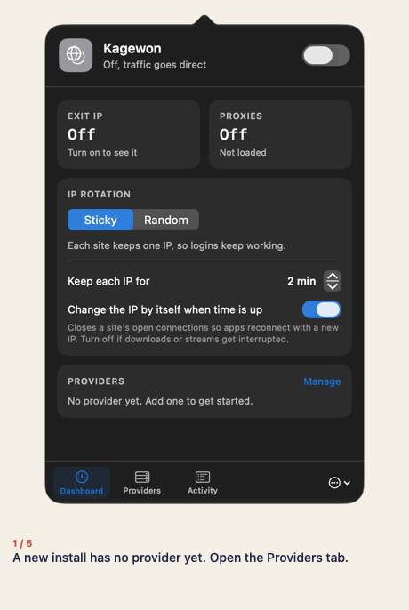
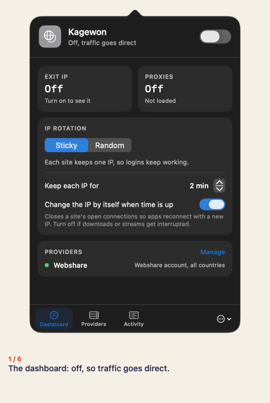
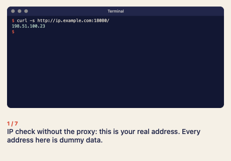
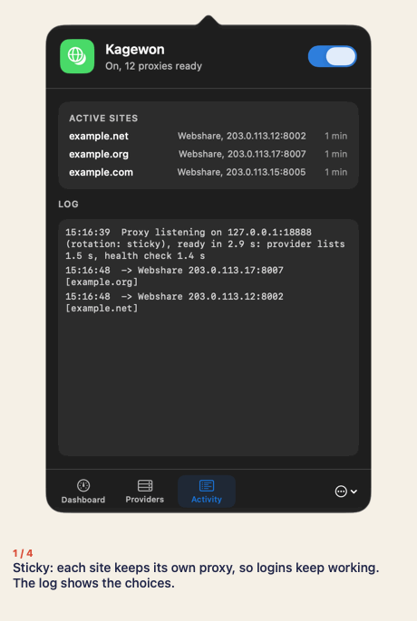
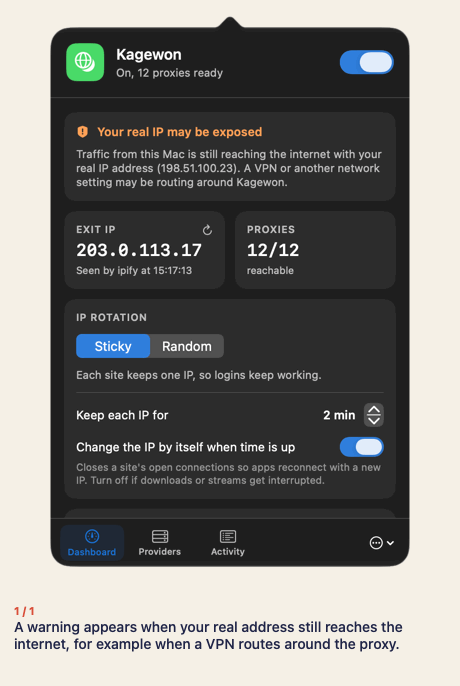
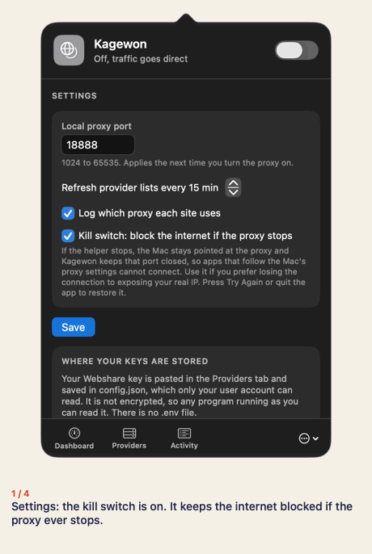
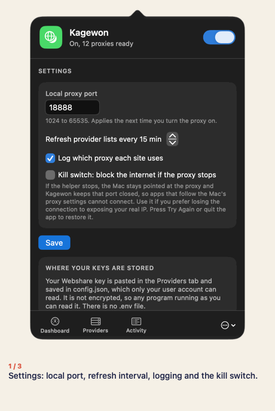
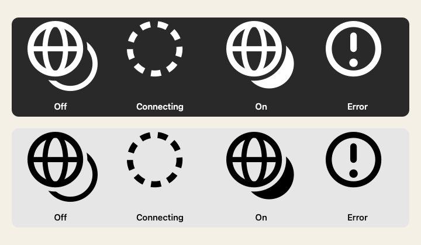

# Demo

These recordings show every flow. They were made with the real app and helper, but with made-up data: a fake Webshare service,
twelve dummy proxies, a dummy API key, and addresses from the ranges reserved for documentation (`203.0.113.0/24` and
`198.51.100.0/24`). A stand-in replaces the Mac's network settings, so no real account, address, or setting appears. The Terminal
recording runs the real `curl` commands against the demonstration helper and draws their real output; it is not a screenshot of
a Terminal window. You can record them again with [`scripts/demo/run-demo.sh`](../scripts/demo/run-demo.sh).

## Add a provider

## Turn the proxy on and off

## Terminal: IP check, curl, and rotation

## Sticky and Random rotation

## A warning when your real address is exposed

## Kill switch

## Settings and Tor

## Menu bar icon

